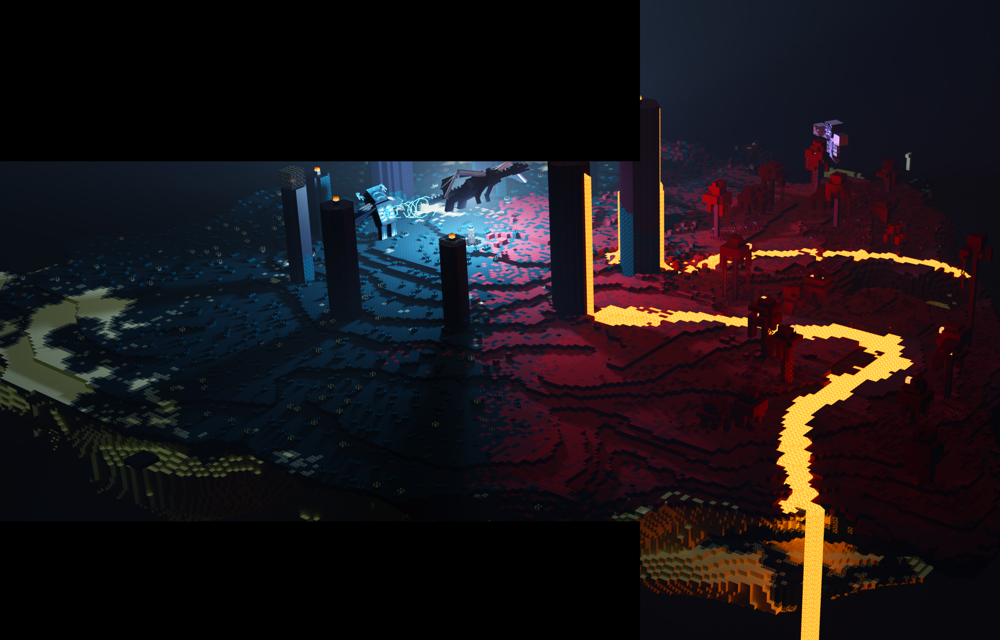
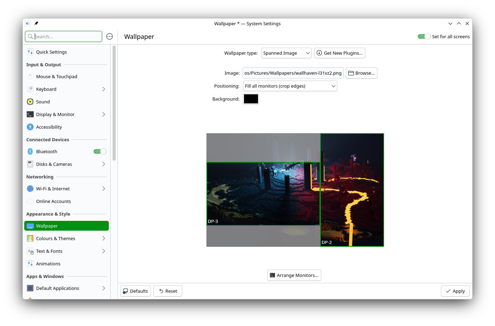

# Spanned Image

A KDE Plasma 6 wallpaper plugin that stretches **one image across all of your monitors**.

The image is laid over the combined area of your screens, and each monitor shows its own
slice, so the picture continues across the bezels. It follows your actual monitor
arrangement from Display Configuration, including offset monitors, portrait screens and
monitors of different sizes. Parts of the image that fall in gaps between monitors are
cropped away.


<sub>Wallpaper: Minecraft artwork via [Wallhaven](https://whvn.cc/l31vz2), see [Credits](#credits).</sub>

## Features

- One image spanned across any number of monitors, in any arrangement
- Three positioning modes: fill (crop edges), fit, or stretch
- Live preview of exactly which part of the image lands on each monitor
- **Arrange Monitors…** button
- Works on the lock screen too
- Drag an image onto the desktop to use it

## Requirements

Plasma 6.0 or newer.

## Install

**From the KDE Store (recommended):** System Settings → Wallpaper → **Get New Plugins…** →
search for *Spanned Image* → Install.

**From source:**

```bash
git clone https://github.com/MakrisJr/plasma-multi-screen-wallpaper.git
cd plasma-multi-screen-wallpaper
./install.sh
```

## Usage

### Desktop

1. Open System Settings → **Wallpaper** (or right-click the desktop → *Desktop and
   Wallpaper*).
2. Set **Wallpaper type** to **Spanned Image**.
3. Click **Browse…** and pick an image.
4. Click **Apply**.



In System Settings, **Set for all screens** is switched on for you, so every monitor gets
its slice. In older dialogs without that switch, click **Use on all monitors** instead.

If the image doesn't line up across the bezels, click **Arrange Monitors…** and adjust
your monitor positions. The preview follows along.

### Lock screen

System Settings → **Screen Locking** → **Appearance** → Wallpaper type **Spanned Image**.
The lock screen uses one setting for every monitor, so the image spans all of them
automatically.

### Command line

```bash
./span-wallpaper.sh ~/Pictures/panorama.jpg               # fill (crop edges), the default
./span-wallpaper.sh ~/Pictures/panorama.jpg fit '#202020' # fit, with a background color
```

## Positioning modes

| Mode | What happens |
|------|--------------|
| Fill (crop edges) | The image covers the whole combined area. Whatever overflows is cropped, keeping the center. |
| Fit | The whole image is visible. Leftover space uses the background color. |
| Stretch | The image is stretched to the combined area, ignoring its aspect ratio. |

## Tips

- Pick an image at least as large as the combined area of your monitors, for example 3000×1920 for a 1920×1080 landscape screen next to a 1080×1920 portrait one.
- Positions are in Plasma's logical pixels, so the image lines up physically when your monitors have similar pixel density. If one monitor has a very different DPI, adjust its scale in Display Configuration so things look the same size on both.

## Uninstall

Remove it from **Get New Plugins…**, or run:

```bash
./uninstall.sh
```

## Development

| Path | Purpose |
|------|---------|
| `package/` | The plugin itself (a Plasma/Wallpaper KPackage) |
| `package/contents/ui/main.qml` | Wallpaper entry point. Works out this monitor's position in the combined area. |
| `package/contents/ui/SpannedView.qml` | Draws this monitor's slice of the image |
| `package/contents/ui/config.qml` | Settings page with the preview |
| `package/contents/ui/span.js` | Shared helpers: combined area, the all-screens switch, desktop scripting |
| `install.sh` / `uninstall.sh` | Install into `~/.local/share/plasma/wallpapers` |
| `package.sh` | Builds `dist/spanned-image-<version>.tar.gz` for the KDE Store |
| `test/harness.qml` | Renders `SpannedView` offscreen for a fake monitor layout |

After changing the code, run `./install.sh` again and restart plasmashell:

```bash
systemctl --user restart plasma-plasmashell
```

To check the slicing without touching your desktop:

```bash
QT_QPA_PLATFORM=offscreen qml6 test/harness.qml -- image.png out.png 2 \
  '[{"virtualX":0,"virtualY":462,"width":1920,"height":1080},{"virtualX":1920,"virtualY":0,"width":1080,"height":1920}]'
```

The third argument is the fill mode: 2 = fill, 1 = fit, 0 = stretch.

### Releasing

1. Bump `Version` in `package/metadata.json`.
2. Run `./package.sh`.
3. Upload `dist/spanned-image-<version>.tar.gz` to the store listing.

## License

The plugin code is licensed under [GPL-2.0-or-later](LICENSE).

## Credits

The wallpaper in the screenshots is a piece of Minecraft artwork, [*The Battle of the End has begun*](https://www.reddit.com/r/Minecraft/comments/vfgjo7/the_battle_of_the_end_has_begun_4k/), originally posted on r/Minecraft. Found via [Wallhaven](https://whvn.cc/l31vz2). The image belongs to its original creator, and Minecraft is a trademark of Mojang Studios. The wallpaper is **not** part of this repository's GPL license and is only shown to demonstrate the plugin.
